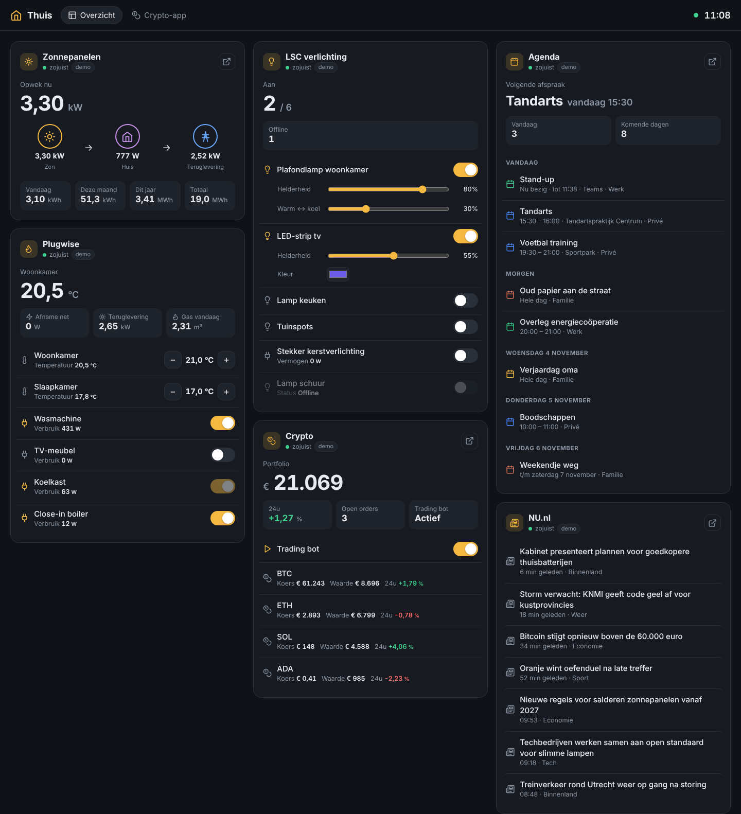

# Thuisdashboard

Eén status- en bedieningsscherm voor je hele huis: **Plugwise**, **LSC Smart Connect-lampen**,
**SolarEdge-zonnepanelen**, je **agenda** (DigiCal / Google Agenda), **nieuws van NU.nl** en je
**eigen apps** (zoals je crypto-applicatie). Draait op elke
machine met Node.js of Docker (Raspberry Pi, NAS, thuisserver) en werkt in de browser op pc,
telefoon of een tablet aan de muur. Je kunt het op je beginscherm zetten als app (PWA).



```
Browser / tablet  ──►  Thuisdashboard (Node)  ──►  Plugwise Smile/Adam   (lokaal, XML-API)
                                                ├─►  Tuya Cloud           (LSC-lampen/stekkers)
                                                ├─►  SolarEdge API        (zonnepanelen)
                                                ├─►  Agenda's (iCal)      (Google/DigiCal, iCloud, Outlook)
                                                ├─►  NU.nl (RSS)          (nieuws)
                                                └─►  Jouw app (JSON)      (bv. crypto)
```

De server haalt alles op de achtergrond op en bewaart de laatste stand. Zo blijven
wachtwoorden en API-sleutels op de server, heb je geen CORS-problemen en blijf je binnen de
limieten van de API's (bijv. SolarEdge: max. 300 verzoeken per dag).

## Snel starten

```bash
cd home-dashboard
npm install
npm start            # → http://localhost:8080
```

Zonder `config.json` start het dashboard met **demodata** (`config.example.json`), dus je ziet
meteen hoe het werkt. Daarna stel je het in:

```bash
cp config.example.json config.json
cp .env.example .env     # vul hier je wachtwoorden en sleutels in
```

Zet per integratie `"demo": false` (of haal de regel weg) zodra de gegevens kloppen.

### Met Docker

```bash
cp config.example.json config.json && cp .env.example .env   # en invullen
docker compose up -d --build
```

## Configuratie

`config.json` bevat een lijst `integrations` (tegels op het overzicht) en `apps`
(volledige apps in een eigen tabblad). In elke tekst wordt `${NAAM}` vervangen door de
waarde uit `.env`, zodat geheimen niet in de config staan.

Opties die voor elke tegel gelden:

| Veld | Betekenis |
| --- | --- |
| `id`, `name`, `icon` | Naam en icoon (`sun`, `bulb`, `plug`, `flame`, `thermometer`, `coins`, `zap`, `home`, `calendar`, `news`, `grid`) |
| `type` | `plugwise`, `lsc` (= `tuya`), `solaredge`, `calendar`, `nunl`, `rss`, `http-json` |
| `demo` | `true` = nepdata, handig om te testen |
| `pollSeconds` | Hoe vaak de server ophaalt (standaard per type) |
| `openUrl` | Knop om de originele app/website te openen |
| `wide` | Tegel over de volle breedte |

### Plugwise (Smile P1, Anna, Adam, Stretch)

```json
{ "type": "plugwise", "name": "Plugwise", "host": "192.168.1.50", "password": "${PLUGWISE_PASSWORD}" }
```

- `password` is de **Smile-ID** (8 letters) op de sticker van de gateway.
- `username` is standaard `smile`; bij een Stretch gebruik je `stretch`.
- Toont P1-verbruik/teruglevering en gas, thermostaatzones (temperatuur instellen met −/+)
  en Circle/Plug-stekkers (aan/uit en verbruik). Werkt volledig lokaal.

### LSC Smart Connect-lampen en -stekkers

LSC (Action) draait op het **Tuya**-platform. Bediening gaat via de Tuya Cloud API:

1. Maak een gratis account op [platform.tuya.com](https://platform.tuya.com) → *Cloud* →
   *Create Cloud Project* (datacenter **Central Europe**).
2. Abonneer het project op de API's *IoT Core* en *Authorization*.
3. Ga naar *Devices* → *Link App Account* en scan de QR-code met de **LSC Smart Connect**-app
   (Ik → instellingen → scan). Je lampen verschijnen nu in het project.
4. Zet *Access ID* en *Access Secret* in `.env`.

```json
{ "type": "lsc", "name": "Verlichting", "region": "eu", "accessId": "${TUYA_ACCESS_ID}", "accessSecret": "${TUYA_ACCESS_SECRET}" }
```

Zonder `devices` worden alle apparaten van het gekoppelde account getoond. Wil je een selectie
of eigen namen: `"devices": [{ "id": "bf12...", "name": "Plafondlamp" }]`.
Bediening: aan/uit, helderheid, warm/koel wit en kleur (afhankelijk van de lamp).

### SolarEdge

```json
{ "type": "solaredge", "name": "Zonnepanelen", "siteId": "${SOLAREDGE_SITE_ID}", "apiKey": "${SOLAREDGE_API_KEY}" }
```

API-sleutel en site-ID vind je in het SolarEdge monitoringportaal onder
*Beheer → Sitetoegang → API-toegang*. Standaard wordt elke 10 minuten opgehaald
(de API staat 300 verzoeken per dag toe). Met een SolarEdge-meter zie je ook de
energiestroom zon → huis → net. Zet `"powerFlow": false` als je geen meter hebt.

### Agenda (DigiCal)

DigiCal is een agenda-app op je telefoon; de afspraken zelf staan in de agenda's die eraan
gekoppeld zijn (meestal **Google Agenda**, soms Outlook of iCloud). Het dashboard leest die
agenda's rechtstreeks via hun **geheime iCal-adres** — wat je in DigiCal ziet, zie je hier ook.

Google Agenda: ga op een computer naar [calendar.google.com](https://calendar.google.com) →
⚙ *Instellingen* → kies links je agenda → *Agenda integreren* → kopieer
**Geheim adres in iCal-indeling** en zet het in `.env`. Herhaal per agenda (privé, werk, gezin…).

- iCloud: agenda delen als *openbare agenda* en de `webcal://`-link gebruiken.
- Outlook/Office 365: *Instellingen → Agenda → Gedeelde agenda's → Agenda publiceren* (ICS-link).

```json
{ "type": "calendar", "name": "Agenda", "days": 7, "maxItems": 15,
  "calendars": [
    { "name": "Privé", "url": "${AGENDA_PRIVE_ICS}", "color": "#4f8cff" },
    { "name": "Werk",  "url": "${AGENDA_WERK_ICS}",  "color": "#3ecf8e" }
  ] }
```

Toont de volgende afspraak groot, en daaronder de komende dagen gegroepeerd per dag
(herhalende afspraken, hele-dag-afspraken en tijdzones worden correct verwerkt).
Behandel het geheime adres als een wachtwoord: iedereen met de link kan je agenda lezen.
De tijdzone stel je in met `"timezone"` bovenin de config (standaard `Europe/Amsterdam`).

### Nieuws (NU.nl en andere RSS-feeds)

```json
{ "type": "nunl", "name": "NU.nl", "categories": ["Algemeen", "Tech"], "maxItems": 8 }
```

Rubrieken zijn o.a. `Algemeen`, `Binnenland`, `Buitenland`, `Economie`, `Sport`, `Tech`,
`Entertainment`, `Wetenschap` en `Gezondheid` (ze worden `https://www.nu.nl/rss/<rubriek>`).
Klik op een kop om het artikel te openen. `"images": false` verbergt de thumbnails.

Elke andere nieuwssite met RSS of Atom werkt ook:

```json
{ "type": "rss", "name": "Tweakers", "feeds": [{ "url": "https://feeds.feedburner.com/tweakers/mixed", "name": "Tweakers" }] }
```

### Eigen app (bijv. je crypto-applicatie)

Type `http-json`. Er zijn twee manieren:

**A. Je app levert zelf het dashboard-formaat (aanbevolen, je hebt alles zelf in de hand).**
Voeg in je app een endpoint toe, bijvoorbeeld `GET /api/dashboard`:

```json
{
  "summary": { "label": "Portfolio", "value": 21053.12, "unit": "€", "decimals": 0 },
  "metrics": [
    { "label": "24u", "value": 1.2, "unit": "%", "trend": "up" },
    { "label": "Open orders", "value": 3 }
  ],
  "items": [
    { "id": "bot", "name": "Trading bot", "icon": "play",
      "controls": [{ "key": "on", "type": "toggle", "value": true }] },
    { "id": "BTC", "name": "BTC", "icon": "coins",
      "metrics": [{ "label": "Koers", "value": 61250, "unit": "€" }] }
  ]
}
```

```json
{ "type": "http-json", "name": "Crypto", "icon": "coins",
  "url": "http://192.168.1.60:3000/api/dashboard",
  "controlUrl": "http://192.168.1.60:3000/api/dashboard/control",
  "headers": { "Authorization": "Bearer ${CRYPTO_TOKEN}" } }
```

Bedient iemand een knop, dan krijgt `controlUrl` een `POST` met
`{ "deviceId": "bot", "key": "on", "value": false }`.

Per item kun je ook `subtitle`, `href` (klikbare link), `image`, `color` en `group`
(kopje boven een groep items) meegeven.

Beschikbare controls: `toggle` (aan/uit), `range` (`min`, `max`, `step`, `unit`, optioneel
`stepper: true` voor −/+ knoppen), `color` (`#rrggbb`) en `button` (`label`).

**B. Je app heeft al een JSON-API.** Koppel velden met paden, zonder je app aan te passen:

```json
{ "type": "http-json", "name": "Crypto", "url": "http://192.168.1.60:3000/api/portfolio",
  "summary": { "label": "Totaal", "path": "totalValue", "unit": "€" },
  "metrics": [{ "label": "24u", "path": "change24h", "unit": "%", "colorBySign": true }],
  "list": { "path": "positions", "name": "symbol",
            "metrics": [{ "label": "Waarde", "path": "value", "unit": "€" }] },
  "actions": [{ "label": "Bot pauzeren", "url": "http://192.168.1.60:3000/api/bot/pause", "method": "POST" }] }
```

### Volledige apps in een tabblad

```json
"apps": [{ "name": "Crypto-app", "url": "http://192.168.1.60:3000", "icon": "coins" }]
```

Elke app krijgt een tabblad bovenin en wordt ingesloten (iframe). Een app blijft actief
wanneer je wisselt. Let op: sommige sites (o.a. SolarEdge, banken, exchanges) staan
insluiten niet toe; gebruik daar `openUrl` op een tegel. Bij je eigen app mag de server
geen `X-Frame-Options: DENY` meesturen.

## Beveiliging

- Zet `DASHBOARD_PASSWORD` in `.env` om inloggen te vereisen (HTTP Basic). Doe dit zeker als
  het dashboard buiten je thuisnetwerk bereikbaar is — het kan apparaten bedienen.
- Gebruik voor toegang van buitenaf liever een VPN (bijv. Tailscale/WireGuard) dan een open poort.

## Ontwikkelen

```bash
npm run dev   # herstart bij wijzigingen
npm test
```

Een nieuwe integratie toevoegen: maak een klasse in `src/integrations/` die `Integration`
uitbreidt (`fetchStatus()` en optioneel `control()`), en registreer het type in
`src/integrations/index.js`. Het dataformaat staat beschreven in `src/integrations/base.js`.
De frontend (`public/`) heeft geen build-stap nodig.
